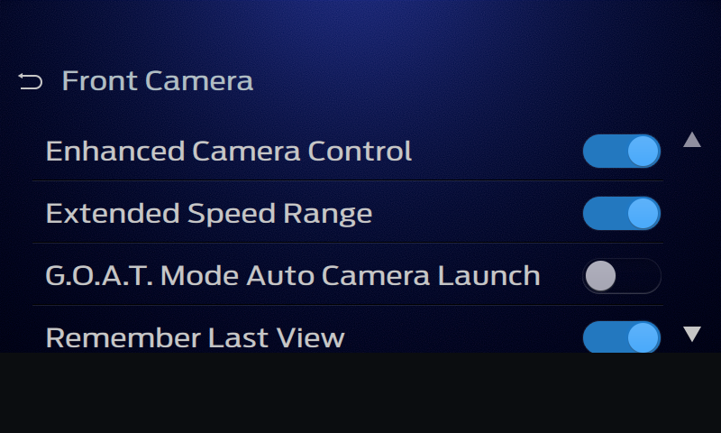

# Enhanced Camera Control

Howdy all,

If you've got a Bronco Sport with the front camera you know the drill: it shuts itself off at 6 mph, pops open on its
own every time you pick a G.O.A.T. mode, and generally does whatever it wants. This mod makes the front camera do what
the button says. Press it, it's on. Press it again, it's off. That's it.

It also works up to about 19 mph instead of 6 (or 15 in the off-road modes), which is a real help in sand or anywhere
that tall nose hides what's right in front of you.

## What it does

- **The button decides.** Nothing opens the camera by itself, and a drive mode ending doesn't yank it away. Shifting
  into Park closes it, and after Reverse it goes back to however you left it.
- **Up to about 19 mph.** SYNC's own front camera speed limits get lifted. Above 20 mph the camera module itself stops
  sending a picture (measured on my truck, it drops out right at 20 every time, and there's no way around that from
  SYNC's side). So instead of leaving you staring at a black screen, the camera closes just under 20 and comes back on
  its own once you slow down, if you had it on.
- **No more nag.** Ford's "for your safety" message only shows up for a press above that limit, where there's
  actually nothing to show.
- **G.O.A.T. mode auto launch is your call.** There's a switch for it. Turn it off and picking an off-road mode never
  flashes the camera on.
- **Remembers your view.** Normal or 180 degree split, it comes back the way you had it.

Everything happens in SYNC's memory only: nothing on SYNC's storage is changed for it, and a restart without the mod
is completely stock. The rear camera isn't touched. It only sends the camera module the same "show this view" / "off"
requests SYNC's own screens send; it doesn't read or clear any module.

## What you need

- A Bronco Sport with the factory front camera and SYNC 3 on build **3.4.23188** (the installer refuses any other).
- The F-Mods jailbreak with **FMods Tools 2.8 or newer**.
- A FAT32 USB stick.

## Install

1. Grab the zip from this repository's [Releases](https://github.com/Trist0ne/enhanced-camera-control/releases) page
   (or build it yourself, below). Copy `DONTINDX.MSA` and the `SyncMyMod` folder to the top of an empty FAT32 stick.
   One mod per stick, since every F-Mods mod uses the same `SyncMyMod` folder name.
2. Truck PARKED, engine running. Plug the stick into SYNC and wait for "installed" on the screen.
3. Pull the stick. SYNC restarts and you're done.

To remove it, same deal with the uninstall zip. SYNC's files are put back exactly how they were. (Building it
yourself: `./build.sh --uninstall`, or set `UNINSTALL=1` in `SyncMyMod/install.conf`.)

## Settings

Everything lives under Settings > Vehicle > Driver Assistance > Front Camera:

| Switch | On | Off |
|---|---|---|
| Enhanced Camera Control | The mod is active. | The camera is stock in every respect; the three switches below are greyed and do nothing. |
| Extended Speed Range | The front camera works up to about 19 mph. | Stock speed limits (6 mph; 15 in off-road modes). |
| G.O.A.T. Mode Auto Camera Launch | Selecting an off-road mode opens the camera by itself, as stock. | Only the button opens it. |
| Remember Last View | Reopens in the view used last. | Always opens in the normal view. |

## Good to know

- **It closes at about 19 mph and comes back on its own.** Above 20 the module sends nothing, whatever SYNC asks; left
  open you'd get a black screen and then "camera unavailable". So it closes just before that and reopens once you
  slow down, if you had it on.
- **The first minute after SYNC starts.** The bit that keeps an off-road mode from flashing the camera needs 30 to 50
  seconds to get set up after SYNC boots. Pick a mode in that window and you might see one quick flash.
- **If SYNC restarts while you're driving** (installing on the move, say: don't), it can lose track of the rear camera
  and leave it stuck on, ignoring the button. The mod ends it the same way SYNC normally would, as soon as you're over
  6 mph.
- **The rear camera is left alone.** Reverse, and Ford's delay after it, work as stock.

## If something goes wrong

- **Turn it off:** flip "Enhanced Camera Control" off on the settings page and the camera is stock instantly.
- **Remove it:** the uninstall stick puts Ford's files back exactly how they were.

## See also

[Front Tire Guides](https://github.com/Trist0ne/front-tire-guides): tire guides on the same camera. The two mods are
independent and share one "Front Camera" settings page.

## What it changes on SYNC

Everything below is removed by the uninstaller, and Ford's files are restored byte for byte.

| What | Where |
|---|---|
| The programs | `/fs/images/fmods_apps_data/EnhancedCameraControl` |
| Its settings and working files | `/fs/rwdata/camcontrol` |
| One line in SYNC's startup script, after the line that launches SYNC's services | `/fs/mp/scripts/startup_gf.sh` |
| Its switches on the camera settings page; a "Front Camera" entry in Driver Assistance | `RVCSettings.qml`, `DriverAssistSettingsMenu.qml` |

The "Front Camera" entry is shared with Front Tire Guides: either mod can be installed or removed without the other,
and the entry goes with the last of them.

## How it works

- **`program/latch.c`** is the rule itself, as a small state machine with no SYNC code in it: what the driver wants
  (from the button), what the camera module is showing, and when a request is needed to make the two agree.
- **`program/camctl.c`** connects it to SYNC: the camera module's reports and the button from SYNC's vehicle-data
  service, the gear from SYNC's notification service, and the requests it sends.
- **`program/rvcpatch.c`** lifts the speed limits in the running camera program's memory. It checks that the bytes it
  is about to change are exactly this build's, and stops for good if they are not. The same program, given
  `installer/popup.places`, moves the speed above which SYNC's HMI program shows Ford's safety message for a press.
- **`program/gate.c`** (inside `camctl`) makes that same camera program refuse a front view while the driver does not
  want the camera and "G.O.A.T. Mode Auto Camera Launch" is off, so a mode's own opening is never drawn. One byte in
  memory, checked the same way, put back the moment the button is pressed; `camctl -r` puts it back for good.

## Building

`./package.sh` packs the install and uninstall sticks as zip files for a release. `./build.sh [out dir]` builds the
stick folder (QNX 6.5 armle-v7, cross-compiled in a Docker image: `QNX_IMAGE`, `QNX_CC`).

No Ford software is included here.

## Support

This is free. If it saved you a bumper (or just some annoyance) and you want to buy me a coffee, there's a tip jar at
[ko-fi.com/trist0n](https://ko-fi.com/trist0n). Totally optional, and thanks either way!

## Disclaimer

An independent hobby project. It is not made, endorsed or supported by Ford Motor Company or by F-Mods, and it
contains none of their software. It changes how your truck's infotainment system behaves: you install and use it at
your own risk, and it may affect your warranty. The camera is an aid; look outside before you move.

## License

MIT: see [LICENSE](LICENSE).
